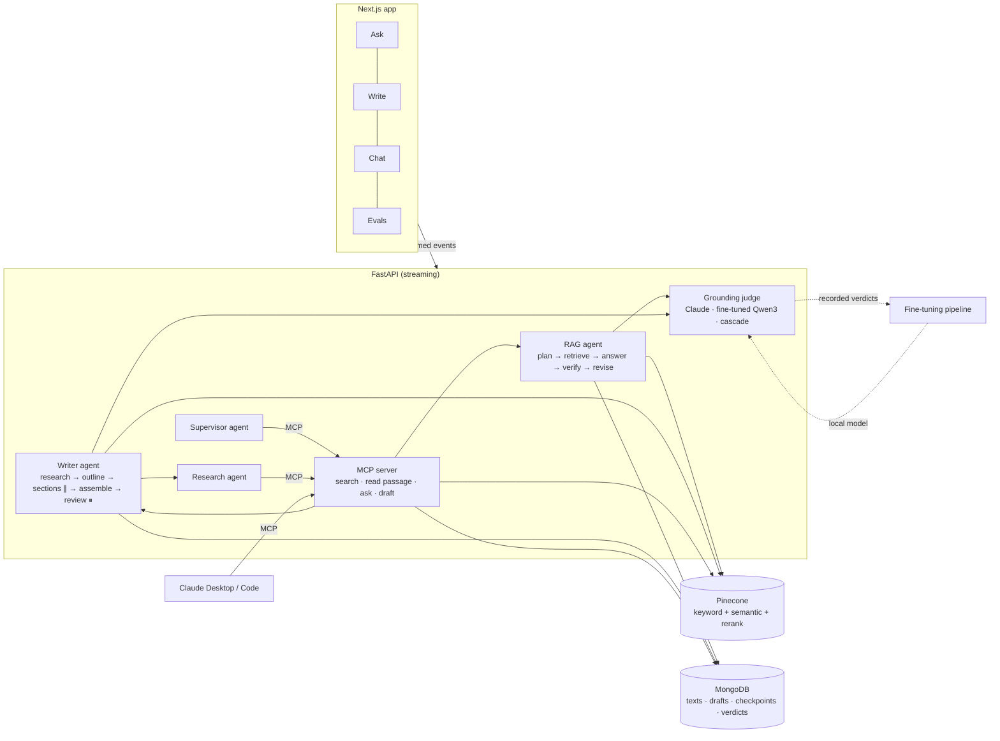

# Footnote

**An AI research assistant that cites every sentence and removes what it cannot prove.**

Footnote makes scholarly work readable for people outside academia. Students and other readers ask
questions about scholars and their research, and get answers that link every sentence to the
passage it came from. Researchers turn a paper into a short article for a chosen reader, from a
fourth grader to a general adult, and approve it before it is published. In both cases an
independent judge model checks each claim first. A claim it cannot trace to a source is rewritten
once. If it still fails, it is removed and shown to the reader as withheld.

The collection pairs public-domain writings and biographies of historical Black American scholars,
writers and educators with openly licensed research papers by contemporary researchers. Every
passage carries its licence and attribution, from the moment it is ingested to the citation a reader
clicks.

[Why it exists](#why-it-exists) · [Use cases](#use-cases) · [Capabilities](#capabilities) ·
[Reliability](#how-reliability-is-enforced) · [Architecture](#architecture) · [Engineering](#engineering-highlights) ·
[Evaluation](#evaluation) · [Roadmap](#roadmap) · [Data](#data-and-licensing) · [Technology](#technology) ·
[Documentation](#documentation)

---

## Why it exists

Most research never reaches the people it could help. It is written for specialists, and the
language models that could explain it write fluent answers whether or not their sources support
them. For a student learning from an answer, or a researcher whose name is on an article, an
unsupported sentence is a liability. Footnote treats grounding as a hard requirement: if a claim
cannot be traced to a passage, it does not ship.

---

## Use cases

### Learning from research

**For students, teachers and curious readers.** Ask about a scholar or a topic in plain language.
Every sentence of the answer cites the passage it came from, and one click opens that passage with
its source and licence. Questions can be limited to a single scholar's work. When the collection does
not cover a question, Footnote says so plainly instead of guessing.

### Turning research into stories

**For researchers, science communicators and educators.** Choose a paper, or a scholar's body of
work, and a reader: grade 4, grade 8 or general adult. A team of agents drafts the article section by
section, checks every claim against the paper, and checks that the writing suits the reader. The
article then waits for a person, typically the researcher, to approve it or ask for changes, so
nothing is published under a researcher's name without their sign-off.

---

## Capabilities

| Capability | What the user does | What Footnote does |
|---|---|---|
| **Ask** | Asks a question in plain language | Plans one to three searches, retrieves and reranks passages, answers with inline citations, checks every claim, and lists anything withheld |
| **Write** | Chooses a paper or a scholar, writes a brief, and picks a reader: grade 4, grade 8 or general adult | A team of agents selects passages from those sources, drafts sections in parallel, fact-checks each section and checks the reading level. The article then pauses for a person to approve it or request changes |
| **Chat** | Holds an open-ended research conversation | A supervisor agent decides which tools to call, including the Ask and Write agents themselves, and shows each tool call as it happens |
| **Scholars** | Browses the people in the collection | Lists each scholar's works, with the source and licence of every passage, and starts an article from any one of them |
| **Evals** | Reviews system quality | Shows the latest retrieval, answer and judge results, with cost and latency |

---

## How reliability is enforced

1. **Answers cite only what was retrieved.** The answering model sees only the retrieved passages.
   On Claude, citations use the API's native search-result citations, so each one comes back as a
   passage ID rather than as text to parse.
2. **The writer never grades itself.** Each answer is split into atomic claims. A judge running on a
   different model sees only the claim and the passages its sentence cites.
3. **The judge fails closed.** A "supported" verdict whose evidence quote does not actually appear in
   the passages is counted as unsupported.
4. **One revision, then removal.** Failing claims are sent back for one rewrite. Anything still
   unsupported is removed and listed for the reader as withheld.
5. **People approve published writing.** The writer pauses for human review, and the pause survives
   a server restart.

---

## Architecture

The web app streams each agent's progress from the API as it works, so the reader sees every step:
planning, retrieval, drafting, judging and revision. Footnote is also a Model Context Protocol (MCP)
server, and its own agents are MCP clients. The tools the agents use, including the other agents,
are therefore the same tools any MCP client, such as Claude Desktop, can call.

| Agent | Flow | Design notes |
|---|---|---|
| **RAG agent** | Plan → retrieve → answer → verify → revise | Declines out-of-scope questions; writes one search per part of a multi-part question; revision is bounded |
| **Writer agent** | Research → outline → parallel sections → assemble → human review | Each section has its own judge-and-redraft loop; reading level is checked by a Flesch-Kincaid score and an editor model |
| **Supervisor agent** | Tool-using conversation | Calls the other agents as tools; external MCP servers can be attached through configuration |

The full design, with state diagrams, data flow and the reasoning behind each decision, is in
[docs/architecture.md](docs/architecture.md).

---

## Engineering highlights

| Area | Implementation |
|---|---|
| **Retrieval** | Section-aware chunking with exact character offsets; hybrid keyword (BM25) and semantic retrieval in one Pinecone index, merged by reciprocal rank fusion and reranked by a cross-encoder; multi-query planning |
| **Agent orchestration** | LangGraph state machines with conditional loops, parallel fan-out, bounded retries, and a human-in-the-loop pause persisted to MongoDB |
| **Model Context Protocol** | Footnote serves its tools over MCP, locally and over HTTP. Its own agents consume every tool, including each other, through MCP |
| **Fine-tuning** | A QLoRA pipeline (4-bit quantisation, LoRA rank 16) that trains Qwen3-1.7B as the grounding judge, on labels known by construction and split by document. The model can serve on its own or in a cascade that escalates uncertain cases to Claude |
| **Model providers** | Every model decision is a named route that can run on Claude or OpenAI. One setting switches all routes, and routes can be mixed |
| **Operations** | Per-request cost ledger, rate limiting, a daily spending cap, optional API-key authentication with per-owner data isolation, and LangSmith tracing |
| **Testing** | The whole system runs offline against fakes for the models, database and index. CI lints, type-checks and tests every package, and runs the repository contract tests against a real MongoDB |

**Why the judge is the fine-tuning target.** Its task is narrow, its training labels can be built
by construction, and it is easy to score: macro-F1, and recall on unsupported claims. It also runs on
every claim, so it is where a small local model saves the most cost.

---

## Evaluation

Footnote is measured at three levels. Retrieval and answers are scored on questions written by a
model from sampled passages and then reviewed by hand. The judge is scored on a held-out set split
by document, so no document appears in both training and testing.

| Suite | What is measured | Release gate |
|---|---|---|
| **Retrieval** | Keyword, semantic, hybrid, and hybrid with reranking, compared on recall@5, recall@10, MRR and nDCG@10 | Recall@10 ≥ 0.80 and MRR ≥ 0.60 for hybrid with reranking |
| **Answers** | The full agent, graded by a model separate from the in-agent judge, on faithfulness, citation precision, answer relevance and correct abstention | Faithfulness ≥ 0.95, citation precision ≥ 0.95, relevance ≥ 0.70, abstention ≥ 0.80 |
| **Grounding judge** | The API judge, base Qwen3, fine-tuned Qwen3 and the cascade, compared on macro-F1, recall on unsupported claims, valid-output rate, latency and cost | Macro-F1 ≥ 0.80, unsupported recall ≥ 0.90, valid output ≥ 99% |

The gates are release requirements, not measured results. A release is blocked unless a complete
run meets every gate, with at least 50 cases per suite (100 for the judge) and results less than a
week old. Partial, smoke and offline runs can never stand in for a complete run, and no figure is
estimated. Results from the first complete run will be added to this section.

---

## Roadmap

- **Answers at the reader's level.** Ask will take the same reading levels as Write, so a fourth
  grader and an adult get different answers to the same question, each fully cited.
- **A guard on source text.** A model will read each passage before any other model does and set
  aside text that gives instructions instead of reporting work, so nothing inside a source can steer
  the writer or the judge.
- **Limitations coverage.** Articles will be checked for whether they cite the passages in which a
  paper states its own limitations.
- **A young-reader mode.** Stricter topic and safety rules for readers under 18.

---

## Data and licensing

| Source | Content | Licence | Access |
|---|---|---|---|
| **Project Gutenberg** | Works by Du Bois, Woodson, Wells, Washington, Douglass, Miller, Brawley, G. W. Williams and Grimké, published 1845–1921 | US public domain, notice checked per file | Official mirror and catalogue feed |
| **Wikipedia** | Biographies, each pinned to a specific revision | CC BY-SA 4.0 | MediaWiki API |
| **Wikidata** | Birth and death years | CC0 | Entity API |
| **Europe PMC** | Twelve open-access papers on reading and literacy | CC BY or CC0, checked in search and again in the article | REST API |
| **Contemporary research papers** | Open-access abstracts and full texts by contemporary researchers | CC BY 4.0, CC BY-SA 4.0 or CC0, each source re-verified | Imported from a researcher-profile dataset that is not in this repository; licences verified through Crossref, Europe PMC or arXiv records, or the source page |

**Principles**

- **Licence first.** Each document's licence is checked before it is stored. Only US public domain,
  CC BY, CC BY-SA and CC0 are accepted; non-commercial and no-derivatives licences are refused.
- **Attribution travels with the text.** Every passage carries its licence and attribution line, and
  the interface shows it next to the passage.
- **No scraping.** The public corpus is fetched through official APIs and mirrors, and page and file
  fetches honour robots.txt.
- **No private data about living people.** Researchers appear only as the bylines on their papers.
- **Reproducible.** The public corpus is pinned, with Wikipedia revisions recorded and the selected
  papers frozen in a lock file, so it can be rebuilt exactly.

**In practice:** of 535 passages in the researcher dataset, 363 passed licence verification, and 172
were refused because no explicit open licence could be found. The accepted papers form 3,388
indexed, citable passages.

---

## Technology

| Layer | Tools |
|---|---|
| **Backend** | Python, FastAPI, server-sent events |
| **Agents and models** | LangGraph, Anthropic SDK (Claude), OpenAI SDK, MCP Python SDK |
| **Retrieval and storage** | Pinecone (hybrid keyword and semantic search with reranking), MongoDB |
| **Frontend** | Next.js 16, React 19, Tailwind CSS 4 |
| **Fine-tuning and serving** | Hugging Face TRL, PEFT, bitsandbytes, llama.cpp, Ollama |
| **Observability and delivery** | LangSmith, Docker, GitHub Actions, uv |

---

## Repository

| Path | Contents |
|---|---|
| [backend/](backend/) | API, agents, MCP server, ingestion, retrieval and evaluation |
| [frontend/](frontend/) | Web app: Ask, Write, Chat, Scholars, Evals and Data |
| [finetune/](finetune/) | Judge dataset builder, QLoRA training, evaluation, model export and Kaggle notebook |
| [docs/](docs/) | Architecture, API contract and development guide |

---

## Documentation

| Document | Covers |
|---|---|
| [Architecture](docs/architecture.md) | Components, ingestion, retrieval, each agent, MCP, the judge, cost and safety, and known limits |
| [API contract](docs/api-contract.md) | The HTTP, streaming and MCP interfaces |
| [Development guide](docs/development.md) | Running Footnote locally, with or without API keys, and running the evaluations |
| [Fine-tuning](finetune/README.md) | Dataset design, training and serving of the judge |
| [Model card](finetune/MODEL_CARD.md) · [Data card](finetune/DATA_CARD.md) | The judge model and its training data |
