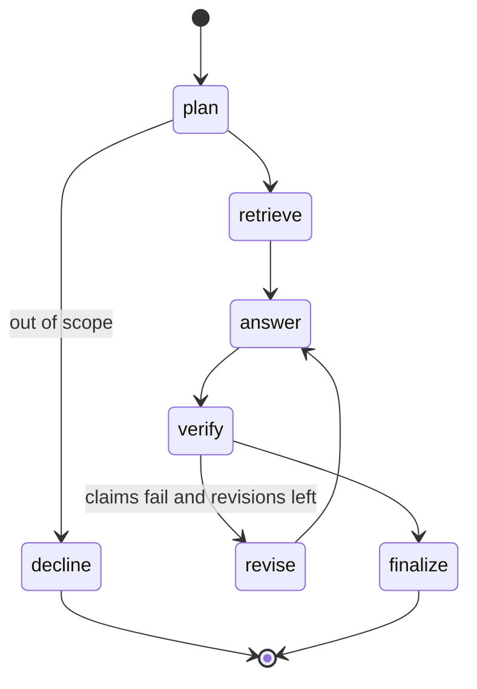
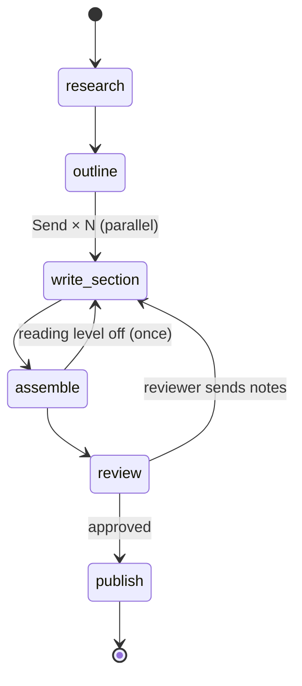

# Architecture

Footnote has one promise: **a reader can trace every sentence to a passage, and the passage to its
licence.** Each design choice below either keeps that promise or makes it cheaper to keep.

## 1. Components

| Layer | Code | Responsibility |
|---|---|---|
| Ingestion | `backend/src/footnote/corpus/` | Fetch from documented sources, check licences, normalise, chunk with exact offsets |
| Storage | `db/repo.py` | MongoDB is the source of truth for text, drafts, judgments, runs and spend. `MemoryRepo` is its offline twin, held to the same contract tests |
| Search | `retrieval/store.py`, `retrieval/retriever.py` | One Pinecone document index (BM25 + hosted dense embeddings), RRF fusion, hosted cross-encoder rerank |
| Models | `llm/client.py`, `config/models.yaml` | Named routes to Claude through the Anthropic SDK: structured outputs, cited answer streams, server-side fallbacks, a cost ledger, LangSmith runs |
| Agents | `agents/` | The RAG agent and the writer (LangGraph), the research agent and the supervisor (Claude's tool runner over MCP), and the grounding judge |
| Protocols | `api/app.py`, `mcp_server/server.py` | REST + SSE for the web app; MCP over stdio and Streamable HTTP for agents and IDEs |
| Fine-tuning | `finetune/` | Dataset by construction, QLoRA on Qwen3, an eval with shared metrics, GGUF + Ollama |
| Web | `frontend/` | Next.js. Every agent event is streamed and drawn: steps, tokens, verdicts, withheld claims, review |

## 2. Ingestion: provenance first

```
corpus.yaml ─▶ fetch (polite: honest UA, per-host pacing, robots.txt for pages, API terms for APIs, disk cache)
           ─▶ licence check (PD notice in the Gutenberg header · CC BY/CC0 in Europe PMC search AND article XML · Wikipedia CC BY-SA, pinned to a revision)
           ─▶ normalise (strip PG boilerplate, transcriber notes, contents/index pages, markup)
           ─▶ chunk (section-aware, paragraph-first, sentence splits for long paragraphs, exact char offsets, no overlap)
           ─▶ MongoDB (documents + chunks)  ─▶ Pinecone (id, text, scholar_ids, document_id, licence)
```

- **Text lives in MongoDB, not in the index.** Pinecone holds what search needs. Every hit is
  hydrated from MongoDB, so a passage is never shown without its licence and attribution line, and
  the index can be rebuilt from the database.
- **No overlap between chunks**, so two passages can never both "contain" the cited sentence; the
  judge and the UI always agree which passage a citation points to.
- **Chunk ids are stable** (`<document>:<ordinal>`) and chunking is deterministic code. Changing
  it changes ids, so it is versioned the way a schema is.
- **Reproducible corpus.** The paper query runs once and its picks are frozen in
  `corpus.lock.json`; documents are content-hashed, so a re-ingest touches only what changed.

## 3. Retrieval

```
query ─┬─ BM25 (Pinecone full-text, stemmed) ─┐
       └─ dense (llama-text-embed-v2, hosted) ┴─▶ RRF (k=60) ─▶ top 24 ─▶ bge-reranker-v2-m3 ─▶ top 8
```

- **Hybrid**, because the corpus mixes period vocabulary (exact names, places, terms of the 1890s)
  that BM25 nails with paraphrased questions that only embeddings catch.
- **RRF, not a weighted sum.** BM25 and cosine scores live on different scales, and RRF needs no
  tuning to fuse them.
- **Multi-query.** The planner splits comparison and multi-part questions into sub-queries, which
  are fused across queries and reranked once against the whole question.
- All four strategies stay selectable (API, MCP tool, UI toggle), so `footnote eval retrieval`
  can report what each stage buys.

## 4. The RAG agent



- **Native citations.** Passages go to Claude as `search_result` blocks, one text block per
  sentence, and come back with citations whose `source` is the passage id. Nothing parses `[3]`
  out of free text.
- **Atomic claims.** A claims step splits the answer into self-contained factual claims, so a
  sentence with two facts can't pass because one of them is true. Framing sentences carry no
  claim and get no verdict.
- **Judge per claim**, against the passages that sentence cites (or all the passages, if it cites
  none). A segment takes its weakest claim's verdict. Claim-extractor omissions are checked as a
  claim themselves; publication requires `supported` plus an explicit citation.
- **Bounded self-correction.** Failing claims are named back to the writer for at most
  `max_revisions` rewrites (policy in `models.yaml`). Anything still unsupported is **withheld**:
  removed from the answer, and returned so the UI can show what was taken out.

## 5. The writer agent: parallel, judged, and human-approved



- **Research is an agent.** It uses MCP tools (`search_passages`, `get_passage`, `get_scholar`)
  to search from several angles and returns structured picks through `output_format`. The outline
  may use only those passages, and each section is bound to its own.
- **Fan-out with `Send`.** Sections draft concurrently. Each runs its own draft → claims → judge →
  redraft loop and then drops what's still unsupported. A section left with no supported prose is
  dropped, with a warning.
- **Reading level** is judged by an editor model, with the Flesch-Kincaid grade as one piece of
  evidence. A misfit sends the note back as guidance for one more round.
- **Human in the loop.** `review` calls `interrupt()`. The draft is saved as `awaiting_review`
  and the run stops. `POST /api/drafts/{id}/review` resumes it with `Command(resume=...)`. The
  MongoDB checkpointer means the pause survives a restart or a scale-to-zero.
- Rounds append sections to state through a reducer, and each round is tagged, so a revision
  never mixes old and new sections.

## 6. MCP and agents that call agents

- **Server.** `mcp_server/server.py` exposes read tools with `read_only_hint` annotations, two
  *agent* tools (`ask_corpus` runs the RAG agent, `start_draft` runs the writer to its review
  pause), resources (`footnote://scholars/{id}`, `footnote://documents/{id}`) and a prompt. It
  serves stdio (`footnote-mcp`) and Streamable HTTP at `/mcp`, with DNS-rebinding protection.
- **Clients.** The research agent and the supervisor connect to that same server in-process
  (`mcp.Client(server)`). The Anthropic SDK's `async_mcp_tool` turns MCP tools into Claude tools.
  The session handed to it is wrapped, so every call is streamed to the UI, traced to LangSmith,
  and (for external servers from `config/mcp_servers.json`) namespaced as `server__tool`.
- **Why everything goes through MCP.** The agents use exactly the tools an outside client sees.
  Adding a capability means adding one tool, and every agent and every IDE gets it.
- **External MCP is untrusted.** Enabled servers require an explicit tool allowlist. Their output
  is discovery-only and cannot become the supervisor's factual answer; a verified `ask_corpus`
  result must supply that answer.

## 7. The grounding judge, and why it's the fine-tuning target

- **One prompt, one schema** (`judge_prompt.py`, standard library only), shared by the API judge,
  the local model and the fine-tune's training data, so every score is comparable. Each passage
  carries its source (author, work, year): without it a judge can't rule that "Wells argued X"
  is supported by Wells's own pamphlet. That was the v1 → v2 change, found in the first live runs.
- **Fail closed.** An invalid reply, or a supported/partial verdict whose evidence isn't a verbatim
  quote from the passages, counts as unsupported.
- **Three backends** behind one interface:
  - `api` (the `judge.grounding` route on either provider, never the writer's model);
  - `local` (the QLoRA fine-tune served by Ollama);
  - `cascade` (local first, escalating `partial` and invalid replies to the API judge).
- **Data flywheel.** Every ruling is recorded with its prompt version. A person sets
  `human_label`, and only those rows can feed the next fine-tune (`footnote export-judgments`).
- **Why the judge, not the writer.** Its labels can be built by construction, its quality is one
  number (recall on unsupported claims), it runs on every claim, and a small local model there
  saves the most money at no visible cost to quality.

## 8. Cost, safety and operations

- **Routes, not model ids.** `models.yaml` sets each decision's provider, model, effort and token
  ceiling. Writer and judge run on different models.
- **Two providers behind one interface.** `llm/client.py` (Claude) and `llm/openai_client.py`
  (OpenAI Responses API) both implement `Models`, and `llm/router.py` sends each route to its
  provider. The one real difference is citations:
  - Claude cites `search_result` blocks natively.
  - OpenAI sees the passages numbered and cites `[n]` markers, which code maps back to passage ids.
    A number that names no passage is dropped, so a citation can never point at something unseen.
  - The tool-using agents have a Claude version (the SDK's tool runner) and an OpenAI version (a
    written-out function-calling loop with `previous_response_id`). Both run over the same MCP
    sessions.
- **Server-side refusal fallbacks** are on for the models that support them. A `refusal` stop
  reason becomes a typed error and a clean SSE `error` event.
- **Ledger.** A per-request `contextvar` ledger adds up tokens and cost across every call a run
  makes, including the tool-runner turns. It's returned in `done`, stored on the run record, and
  counted against a **daily spend ceiling**. A **per-client rate limit** also applies to every route
  that spends tokens.
- **Identity and ownership.** When `FOOTNOTE_API_KEYS` is set, bearer authentication covers both
  API agent routes and the mounted HTTP MCP transport. Drafts carry an owner id and repository
  queries enforce it. Review uses an atomic `awaiting_review` -> `reviewing` claim, preventing two
  approvals from resuming the same graph checkpoint.
- **Evaluation release gate.** Only a complete production `eval all` run can update the displayed
  `latest.json`. It includes dataset hashes, human-review flags, corpus counts, and model routes;
  `eval check` enforces freshness, sample sizes, and the reviewed thresholds in `eval-gates.yaml`.
- **Tracing.** Graph nodes, LLM calls (with usage metadata) and MCP tool calls are LangSmith runs.
  The `run_id` in `done` is the LangSmith root run id.
- **Offline mode** (`FOOTNOTE_OFFLINE=1`): fake models with deterministic rules, `MemoryRepo`, an
  in-memory BM25/hashed-vector store, and a bundled public-domain snapshot. The whole system,
  including real MCP calls, runs in CI and in a keyless demo. No quality number is ever reported
  from it.

## 9. Known limits

- The rate limiter and the offline stores are per process. A multi-replica deployment would move
  them to Redis or MongoDB.
- Wikipedia fetches need an operator contact in the User-Agent (Wikimedia policy). Without one,
  biographies are skipped and the works still load.
- The answer grader is an LLM, which is a known source of bias. That is why the question set is
  reviewed by hand, and why the grader runs on a different model from the judge it measures.
- API-key identity is appropriate for controlled deployments and service clients; a public
  multi-user product should replace it with its OIDC/session provider while keeping the same
  owner-id repository boundary.
